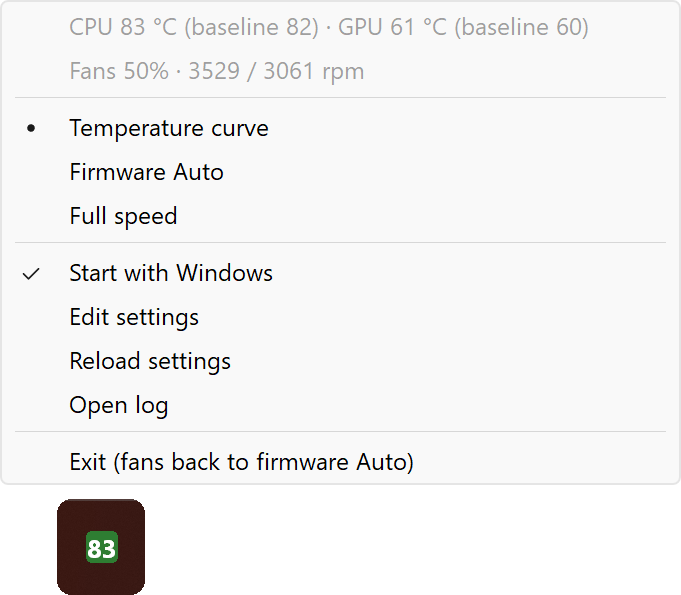

# AcerFan

AcerFan is a small tray app that runs the fans of an Acer laptop from the CPU and GPU temperatures. It uses the same firmware interface as Acer's own PredatorSense, NitroSense and ConceptD Palette.

The goal is **no thermal throttle, not low temperatures**. On some models the Auto mode of the firmware caps the fans far below their maximum. On a ConceptD 9 it stops at about 2,750 rpm while the CPU sits at its 90 °C throttle point, although the fans reach 6,100 rpm. AcerFan leaves the fans to Auto while the chips stay cool and takes over only when heat builds up.

<p align="center">
  
</p>

> **Tested on:** Acer ConceptD 9 (CN917-71, i9-9980HK, RTX 2080) only. Other Acer laptops with PredatorSense, NitroSense or ConceptD Palette expose the same `AcerGamingFunction` interface and probably work, but their sensor and fan ids can differ. Reports are welcome.

## Install

1. Download `AcerFan_vX.Y.Z.zip` from [Releases](https://github.com/tkhquang/AcerFan/releases).
2. Extract it to a folder you keep. AcerFan writes `AcerFan.ini` and `AcerFan.log` next to the exe.
3. Run `AcerFan.exe` and accept the administrator prompt. The exe is not code-signed, so SmartScreen can ask first: pick More info, then Run anyway.
4. Right-click the tray icon and tick **Start with Windows**.

## How it works

- Every 2 seconds AcerFan reads the CPU and GPU temperatures from the firmware.
- The curves act on the **baseline** of each chip: the 25th percentile of the last 2 minutes. Under light, bursty work a laptop CPU flashes to 85-90 °C for a second and drops straight back. Fans cannot help with those flashes, only with heat that stays. A flash or a burst shorter than about 90 seconds does not move the baseline.
- AcerFan takes over only after one full 2-minute window of readings, so the heat burst at logon does not spin the fans up.
- Below the curves the Auto mode of the firmware runs the fans. Once a baseline enters its curve, both fans switch to a custom speed and follow the chip that asks for more:

  | CPU baseline | < 80 °C | 80 °C | 84 °C | 87 °C | 89 °C+ |
  |---|---|---|---|---|---|
  | Fans | Auto | 40% | 60% | 80% | 100% |

  | GPU baseline | < 75 °C | 75 °C | 80 °C | 84 °C | 86 °C+ |
  |---|---|---|---|---|---|
  | Fans | Auto | 40% | 60% | 80% | 100% |

- The speed rises by up to 10% and falls by up to 5% per poll. It falls only after every recent request is lower. Control returns to Auto after both baselines stay cool, the CPU at 74 °C or below and the GPU at 70 °C or below, for 30 seconds.
- Every 10 seconds AcerFan checks that no other app and no resume from sleep changed the fan mode, and re-applies its own.
- On exit, shutdown or an error the fans go back to firmware Auto. When the temperatures stay unreadable for 10 seconds, the fans go to 100%.

`AcerFan.ini` holds every value above. AcerFan creates it next to the exe at the first start.

## Tray menu

- Live temperatures and fan speeds
- Mode: **Temperature curve** (default), **Firmware Auto** or **Full speed**
- **Start with Windows**, a logon task that starts AcerFan elevated without a UAC prompt
- Edit settings, Reload settings and Open log
- Exit, which hands the fans back to firmware Auto

The icon shows the temperature of the hotter chip. It is gray while the firmware runs the fans. Green, orange and red mark a custom speed below 60%, below 85%, and 85% or more.

## Requirements

- Windows 10 or 11, x64.
- Administrator rights. The firmware fan methods answer only elevated processes, so the exe asks for them.
- No other fan tool at a fixed speed. Close PredatorSense, NitroSense or ConceptD Palette, or leave their fan setting on Auto. Two tools fight over the fans otherwise.

For a scripted install, run `AcerFan.exe --autostart on` or `AcerFan.exe --autostart off`.

## Build

Build with Visual Studio 2022 (MSVC, C++23) and CMake 3.28 or later:

```
cmake --preset msvc
cmake --build --preset release
ctest --preset release
```

The build writes `build/msvc/Release/AcerFan.exe`. The exe links the C++ runtime statically and needs no runtime install.

The **Version Bump and Release** workflow on the Actions tab makes each release. Write the notes in `docs/NEXT_CHANGELOG.md`, then run the workflow with patch, minor or major. The workflow bumps the version in `CMakeLists.txt`, updates `CHANGELOG.md`, tags `vX.Y.Z`, builds and tests on `windows-2022`, and publishes the zip.

## Firmware interface

`root\WMI` class `AcerGamingFunction`. Every method takes a 32-bit `gmInput` and returns a 64-bit `gmOutput` whose low byte is a status, 0 for success.

| Purpose | Method | gmInput | Result |
|---|---|---|---|
| CPU / GPU temperature | `GetGamingSysInfo` | `0x0101` / `0x0A01` | °C in bits 23:8 |
| CPU / GPU fan speed | `GetGamingSysInfo` | `0x0201` / `0x0601` | rpm in bits 23:8 |
| Both fans Auto / Custom | `SetGamingFanBehavior` | `0x410009` / `0xC30009` | |
| Fan mode read-back | `GetGamingFanBehavior` | `0x9` | CPU bits 9:8, GPU bits 15:14 (1 Auto, 2 Max, 3 Custom) |
| Custom speed | `SetGamingFanSpeed` | `percent << 8 \| fan` (CPU 1, GPU 4) | |

The encodings match the ones that the Linux `acer-wmi` driver documents. AcerFan contains no code from it.

## Disclaimer

AcerFan writes fan settings to the embedded controller of the laptop, as Acer's own tools do. Whatever the fans do, the CPU and GPU still protect themselves with a throttle and a thermal shutdown. Use AcerFan at your own risk.

## License

[MIT](LICENSE)
